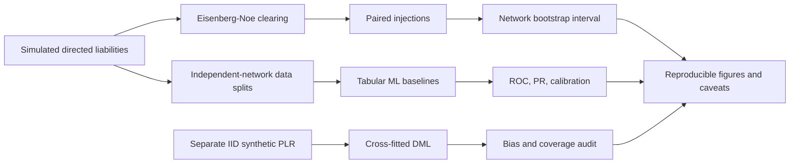

# Network Fragility Under Stress
### Financial Contagion · Graph Machine Learning · Cross-Fitted Econometrics · Mechanism-Consistent Stress Testing

[](https://github.com/muhammad-siddique-research/systemic-causal-gnn/actions/workflows/research.yml)


**Innovative research theme:** *Can mechanism-consistent clearing simulations, network-aware validation, and cross-fitted Double Machine Learning distinguish robust policy scenarios from predictive and identification artifacts?*

> **Evidence classification (essential):** This project currently uses **computer-generated financial networks** and an **independent synthetic partially linear causal experiment**. It does **not** include observed bilateral bank exposures, real policy interventions, clinically observed hospital networks, or identified macroprudential treatment effects. The existing GAT–GRU architecture is exploratory; benchmark scores reported below apply to separately validated **tabular network-feature models**, not automatically to the GNN. See [Data and Identification](docs/DATA_AND_IDENTIFICATION.md).

**Research reading room:** [Scholarly Study (APA 7)](docs/RESEARCH_STUDY.md) · [Data Provenance and Identification](docs/DATA_AND_IDENTIFICATION.md) · [Healthcare Financing Extension](docs/HEALTH_ECONOMICS_TRANSLATION.md) · [Generated Research Report](reports/REPRODUCIBLE_RESULTS.md) · [GitHub Actions](https://github.com/muhammad-siddique-research/systemic-causal-gnn/actions/workflows/research.yml)

## Research at a glance

| Research component | Implemented approach | What is actually evidenced |
|---|---|---|
| **Financial clearing and network effects** | Directed liabilities and Eisenberg–Noe greatest clearing fixed point | Numerical properties of the simulated mechanism |
| **Macroprudential capital allocation** | Same-network and same-shock comparison: equal-budget injections to largest debtor vs. random node | Controlled **model** contrasts; no real policy effect |
| **Computational Econometrics** | Cross-fitted orthogonal partially linear regression; known-truth Monte Carlo | Synthetic IID identification and estimator sensitivity |
| **Predictive Machine Learning** | Logistic regression, Random Forest, boosted trees; split by independent **network**, with separate training, validation and untouched test sets | Out-of-network synthetic default prediction, no node-leakage |
| **Graph neural architecture** | GAT plus temporal GRU, supervised risk output | Prototype model; independent validation separate from headline benchmark |
| **Research integrity** | Reproducible seeds, convergence assertions, robust error handling, CI, audit logs | Transparent simulated evidence and uncertainty boundaries |

### Reproducible research workflow



## Results and scientific figures

The new pipeline runs entirely with a fixed seed and writes both numerical tables and figures. Each figure is labeled **synthetic** and is generated from the actual code rather than hand-written metrics.


*Figure 1. Unpaid-obligation distributions and the difference between equal-budget intervention rules across independently generated synthetic networks. **Not observed financial institutions.***


*Figure 2. Same-network intervention comparisons; adding external resources cannot increase the modeled unpaid obligation at the greatest clearing solution.*


*Figure 3. Evaluation on **unseen network draws** with logistic, Random Forest and gradient-boosted baselines. These are **not** GNN AUROCs.*


*Figure 4. Held-out covariate permutation reliance. Predictive importance is not a causal effect.*


*Figure 5. Cross-fitted DML versus naive regression against a known synthetic partially linear parameter. This does **not** identify real capital-injection effectiveness.*


*Figure 6. One directed synthetic network after a prescribed external-asset shock.*

Numerical results, scenario counts, uncertainty intervals, model metrics and source declarations are regenerated into **[REPRODUCIBLE_RESULTS.md](reports/REPRODUCIBLE_RESULTS.md)** rather than inserted manually.

## Econometric and computational methodology

### Clearing fixed point

For simulated debtor-to-creditor obligations \(L_{ij}\ge 0\), promised payments \(\bar p_i=\sum_jL_{ij}\), relative liabilities \(\Pi_{ij}=L_{ij}/\bar p_i\) for \(\bar p_i>0\), and nonnegative external assets \(e_i\),

$$
p_i^*=\min\Big\{\bar p_i,\ \max[0,\ e_i+\sum_{j}\Pi_{ji}p_j^*]\Big\}.
$$

The implementation starts at full promised payments and iterates downward, reporting convergence and shortfall \(\sum_i(\bar p_i-p_i^*)\). This computes a **greatest** clearing fixed point; uniqueness is not asserted for arbitrary nonregular liability systems (Eisenberg & Noe, 2001).

### Policy comparison as a controlled simulation

For synthetic network \(b\), compare \(\mathcal L_b(0)\), \(\mathcal L_b(\mathrm{target})\) and \(\mathcal L_b(\mathrm{random})\), holding liabilities, initial assets and the shock identical while adding an **equal nominal capital budget**. Report mean paired reductions, default counts, and percentile bootstrap intervals over *independently generated networks*. A shock or injection is **not** empirical identification of a real policy instrument.

### Cross-fitted Double Machine Learning

In the separate *IID synthetic* partially linear model:

$$
Y_i=\theta_0D_i+g_0(X_i)+\varepsilon_i,\qquad
D_i=m_0(X_i)+v_i,
$$

the cross-fitted estimator solves the Neyman-orthogonal moment

$$
\frac{1}{n}\sum_{i=1}^n
\left[D_i-\hat m_{-k(i)}(X_i)\right]
\left\{Y_i-\hat\ell_{-k(i)}(X_i)
-\theta\left[D_i-\hat m_{-k(i)}(X_i)\right]\right\}=0.
$$

Here \(\ell(X)=E[Y\mid X]\), *not* \(g(X)\); training folds never predict their own nuisance values. Inference assumes synthetic IID sampling and valid nuisance approximation. This DML simulation is **not a network spillover estimator** (Chernozhukov et al., 2018).

### Prediction and graph learning

Default outcomes are generated by solving clearing networks. Node attributes are constructed *before* reading the default label. Logistic, Random Forest and boosted classification models are fitted on some independent networks and evaluated on entirely different networks. The original GAT–GRU graph model remains a distinct **exploratory architecture**, not a valid reason to label tabular metrics “GNN performance” (Veličković et al., 2018).

### Hypotheses and scientific boundaries

- **H1:** Equal-budget capital allocation rules produce distinguishable synthetic clearing outcomes under a prespecified network/shock DGP; the direction of comparative performance is an empirical question within that simulator.
- **H2:** Network-grouped predictive evaluation differs from evaluation that mixes nodes of one network across train and test, illustrating possible leakage.
- **H3:** Under a correctly specified *independent-observation* synthetic DML design with known truth, orthogonal cross-fitting may reduce confounding bias relative to naive unadjusted OLS.
- **H4 (planned, NOT tested):** Network financial stress may influence hospital liquidity, provider referral access and insurance payment disruption. Genuine provider financial and relationship data are required.

None is presented as a novel proved theorem or an observation about historical bank failures.

## Quickstart

Python 3.11 or 3.12 is recommended. An ordinary computer can run all default reproducibility checks **without a GPU**.

```bash
git clone https://github.com/muhammad-siddique-research/systemic-causal-gnn.git
cd systemic-causal-gnn
python -m venv .venv
# Linux / macOS: source .venv/bin/activate
# Windows: .venv\Scripts\activate
python -m pip install -r requirements-core.txt

python -m src.research.pipeline --out reports --networks 140 --dml-reps 10
python -m pytest -q tests/test_research.py
```

For the **interactive, simulation-derived** dashboard:

```bash
pip install streamlit
streamlit run app/streamlit_app.py
```

The PyTorch graph model is a separately maintained optional research prototype. Install full dependencies from `requirements.txt` to explore it. It is not silently substituted for a trained GNN benchmark in the main results.

## Output dictionary

| Path | Meaning |
|---|---|
| `reports/REPRODUCIBLE_RESULTS.md` | Code-generated study summary with interpretation |
| `reports/research_provenance.json` | Seed, cohort DGP, results caveats |
| `reports/synthetic_network_policy_pairs.csv` | Independently simulated networks and paired policies |
| `reports/out_of_network_predictive_benchmarks.csv` | Held-out logistic / forest / boosting metrics |
| `reports/heldout_synthetic_calibration.csv` | Reliability summaries of selected synthetic predictive model |
| `reports/heldout_permutation_reliance.csv` | Held-out permutation importance |
| `reports/independent_dml_monte_carlo.csv` | Replicated IID known-truth DML experiments |
| `reports/figures/` | Six figures generated in PNG and SVG |

**Reproducibility caveat:** Perfect reproduction assumes compatible versions of core dependencies; nonlinear tree fits can change slightly across library versions.

## Research direction and Health Economics transfer

Financial network clearing is **not** a hospital claims model. A valid extension could study **hospital financing fragility, delayed insurer reimbursements, and referral disruptions**, but would require genuine provider financial records, a validated provider-to-provider relationship graph, payer shocks, and a defensible evaluation design. [Read the testable translation protocol](docs/HEALTH_ECONOMICS_TRANSLATION.md).

## Academic references (APA 7th edition)

Acemoglu, D., Ozdaglar, A., & Tahbaz-Salehi, A. (2015). Systemic risk and stability in financial networks. *American Economic Review, 105*(2), 564–608. https://doi.org/10.1257/aer.20130456

Chernozhukov, V., Chetverikov, D., Demirer, M., Duflo, E., Hansen, C., Newey, W., & Robins, J. (2018). Double/debiased machine learning for treatment and structural parameters. *The Econometrics Journal, 21*(1), C1–C68. https://doi.org/10.1111/ectj.12097

Eisenberg, L., & Noe, T. H. (2001). Systemic risk in financial systems. *Management Science, 47*(2), 236–249. https://doi.org/10.1287/mnsc.47.2.236.9835

Glasserman, P., & Young, H. P. (2015). How likely is contagion in financial networks? *Journal of Banking & Finance, 50*, 383–399. https://doi.org/10.1016/j.jbankfin.2014.02.006

Glasserman, P., & Young, H. P. (2016). Contagion in financial networks. *Journal of Economic Literature, 54*(3), 779–831. https://doi.org/10.1257/jel.20151228

Veličković, P., Cucurull, G., Casanova, A., Romero, A., Liò, P., & Bengio, Y. (2018). Graph attention networks. *International Conference on Learning Representations*. https://openreview.net/forum?id=rJXMpikCZ

## Research integrity and attribution

The original repo included illustrative graphical panels labeled as “empirical” and a benchmark table claiming specific GNN performance and near-unbiased policy effects. Those claims are **not reproducibly validated** by the historical code and are excluded from the revised reporting. Old files under `assets/` and `src/analytics/` are retained as legacy demonstrations, **not substantiating empirical evidence**. The updated reproducible reports are authoritative.

This code is a **computational methods research portfolio**, not a peer-reviewed article, regulatory stress test, public-health policy evaluation, or substitute for observed financial exposures. MIT license retained.
