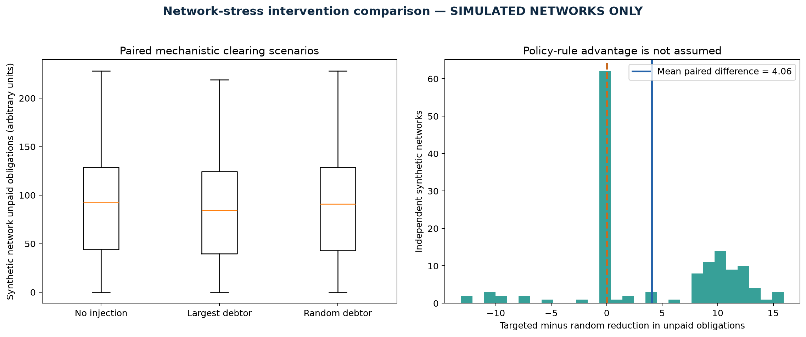
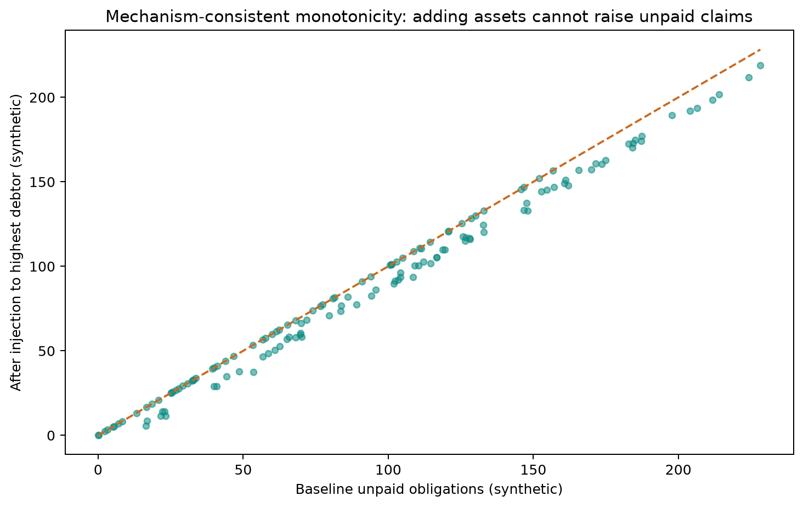
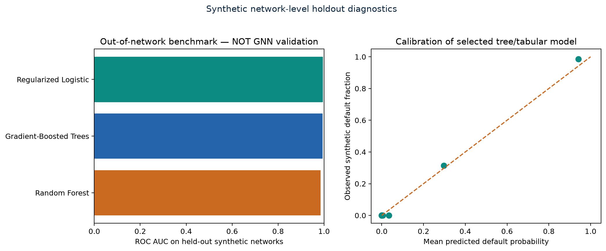
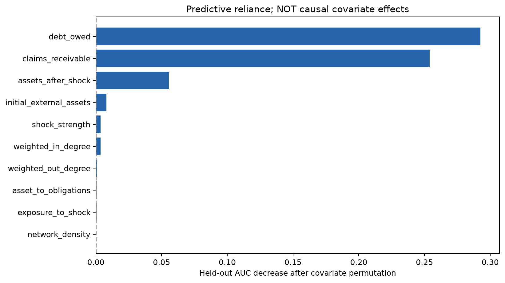
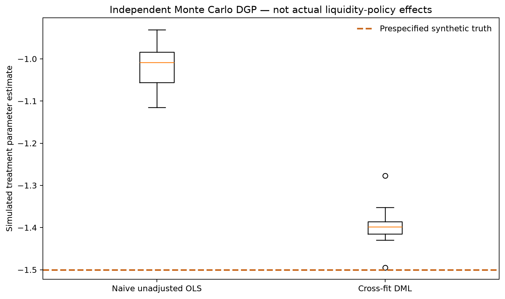
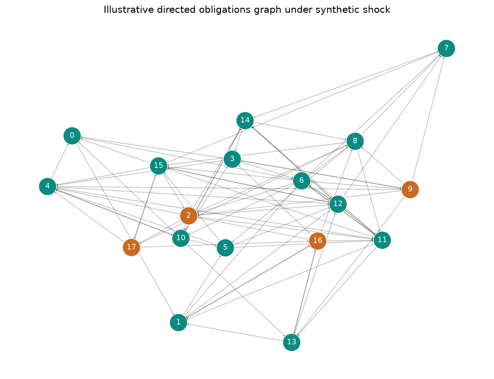

# Reproduced computational results — synthetic benchmark only

**This is not an empirical bank dataset, a trial of real policies, or a validated causal GNN.**

- Independently generated networks: **140**
- Mean baseline unpaid obligations: **93.21 synthetic units**
- Mean loss reduction, injection to largest debtor: **5.86**
- Mean loss reduction, injection to random debtor: **1.80**
- Paired targeted-minus-random mean: **4.06** (bootstrap 95% interval 3.04 to 5.20)

## Out-of-network predictive models

| model                  |   n_train |   n_validation |   n_test |   train_networks |   validation_networks |   test_networks |   test_event_rate |   validation_roc_auc |   roc_auc |   average_precision |   brier |   log_loss | selected_on_validation   |
|:-----------------------|----------:|---------------:|---------:|-----------------:|----------------------:|----------------:|------------------:|---------------------:|----------:|--------------------:|--------:|-----------:|:-------------------------|
| Regularized Logistic   |      1680 |            560 |      560 |               84 |                    28 |              28 |            0.1625 |               0.9956 |    0.9951 |              0.9768 |  0.0222 |     0.0762 | True                     |
| Gradient-Boosted Trees |      1680 |            560 |      560 |               84 |                    28 |              28 |            0.1625 |               0.9919 |    0.9940 |              0.9675 |  0.0263 |     0.0920 | False                    |
| Random Forest          |      1680 |            560 |      560 |               84 |                    28 |              28 |            0.1625 |               0.9875 |    0.9855 |              0.9389 |  0.0438 |     0.1560 | False                    |

**Qualification:** Tabular supervised classifiers (logistic, RF, boosting), not a validated graph neural network. Selection used separate validation networks; final metrics use an untouched network-level test set.

## Cross-fitted DML known-truth exercise

- True synthetic coefficient: **-1.500**
- Mean naive OLS estimate: **-1.019**
- Mean cross-fit DML estimate: **-1.395**
- Mean absolute DML deviation from truth: **0.105**
- Fraction of IID DML 95% CIs covering synthetic truth: **70.00%** (10 simulated replications; not coverage validation).

## Research visuals

## Inference boundary

The paired bootstrap resamples entire independent simulated networks. DML variance relies on IID observations in a separately simulated partially linear model. Neither confidence interval transfers to real interconnected institutions or economic interventions.
